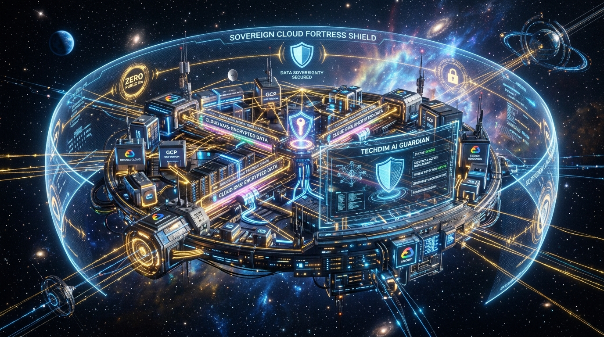

# ☁️ GCP Sovereign Landing Zone
## Módulo Terraform Corporativo para Implantação de Landing Zone Segura e Soberana no Google Cloud



[](https://techdimbr.github.io/techdimbr/)
[](https://www.techdim.com.br)
[](https://cloud.google.com)
[](https://www.terraform.io)
[](README.md)
[](LICENSE)

> **Provisionamento determinístico de Landing Zone soberana no Google Cloud com VPC privada, Zero Public IPs, Cloud NAT de alta performance, acesso administrativo seguro via Identity-Aware Proxy (IAP) e Cloud KMS CMEK com rotação periódica.**

---

## 🏛️ Visão Geral & Proposta de Valor

Projetos em nuvem frequentemente sofrem com configurações negligentes: máquinas virtuais criadas com IPs públicos transitórios, bancos de dados sem encriptação gerenciada pelo cliente e permissões de IAM excessivamente permissivas.

O **GCP Sovereign Landing Zone** resolve esses problemas estruturais entregando uma fundação de nuvem pronta para ambientes regulados e auditorias rigorosas:
1. **Perímetro Zero Public IPs:** Nenhuma instância ou carga de trabalho recebe IP público. Todo o tráfego de saída passa por Cloud NAT com IPs dedicados e previsíveis.
2. **Acesso Remoto Blindado via IAP (Identity-Aware Proxy):** Acesso administrativo SSH e RDP realizado exclusivamente através de túneis criptografados autenticados pelo Google Workspace / Cloud Identity, eliminando a necessidade de Jump Hosts (Bastion Hosts) caros e vulneráveis.
3. **Soberania Criptográfica (Cloud KMS CMEK):** Encriptação de discos, buckets e dados em repouso com Customer-Managed Encryption Keys e rotação periódica automática de 90 dias.

---

## 🏗️ Topologia da Arquitetura Soberana

```mermaid
graph TD
    User["Administrador / Engenheiro"] -->|Túnel Criptografado IAP (Zero Bastion)| IAP["Google Identity-Aware Proxy"]
    IAP --> Workload["Instâncias / GKE (IPs 100% Privados - RFC 1918)"]
    Workload -->|Saída Filtrada| NAT["Google Cloud NAT (IPs Estáticos Fixos)"]
    NAT --> Internet["Internet Externa (APIs / Repositórios)"]
    Workload -->|Criptografia em Repouso| KMS["Google Cloud KMS (CMEK Chaves Soberanas)"]
    Internet -->|WAF & Anti-DDoS L7| Armor["Google Cloud Armor"]
    Armor --> Workload
```

---

## ⚡ Início Rápido

### Pré-requisitos
- Terraform 1.6+ ou OpenTofu 1.7+
- Google Cloud CLI (`gcloud`) autenticado com permissões de `Owner` ou `Editor` no projeto alvo
- Projeto GCP com faturamento ativo

### Comandos de Validação e Aplicação
```bash
# 1. Clonar o repositório
git clone https://github.com/Techdimbr/gcp-sovereign-landing-zone.git
cd gcp-sovereign-landing-zone

# 2. Inicializar o ambiente local
./iniciar.sh

# 3. Validar a conformidade das regras Terraform
python3 03_APLICACAO/src/validator.py --dir 03_APLICACAO/src
```

---

## 🛡️ Governança & Contato Corporativo
- **Autor:** Deivis Írio Mayer (Kether_1)
- **Entidade:** TECHDIM INOVA SIMPLES (I.S.) - ME · CNPJ 61.933.926/0001-24
- **Website Oficial:** [https://www.techdim.com.br](https://www.techdim.com.br)
- **Portal de Soluções:** [https://techdimbr.github.io/techdimbr/](https://techdimbr.github.io/techdimbr/)
